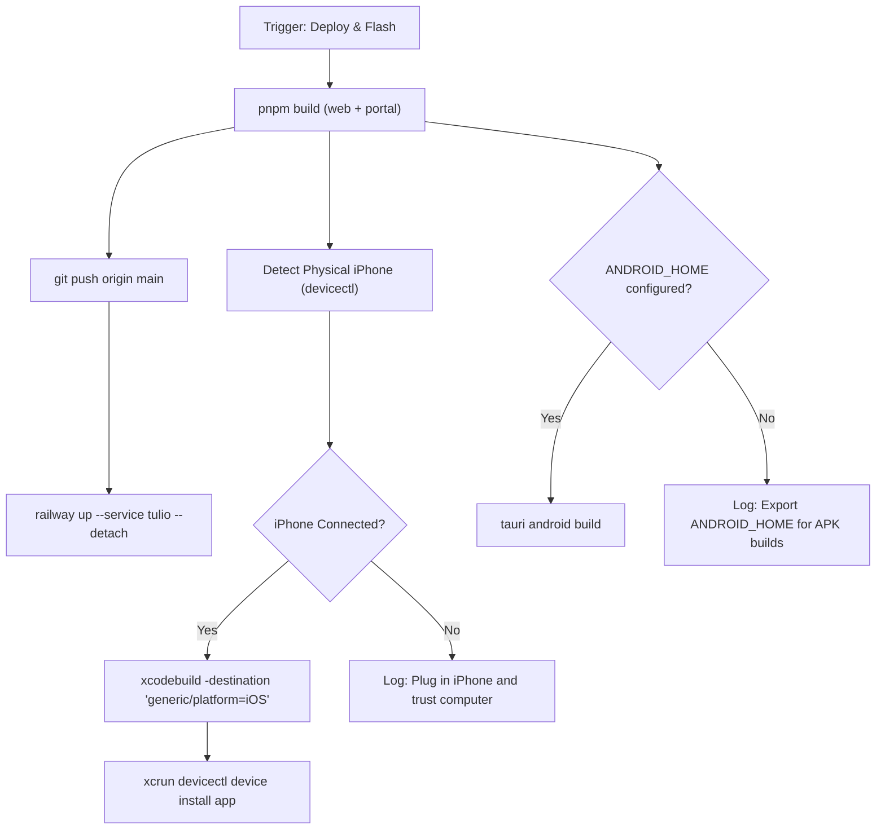

# Mobile Deploy & Flasher Skill

Automate the full end-to-end deployment lifecycle:
1. Compiling production web and portal bundles
2. Syncing GitHub (`origin main`) and dispatching Railway production deployments
3. Building native iOS `.app` bundles with Apple Development code-signing
4. Flashing connected physical iPhones via `xcrun devicectl`
5. Building Android targets via Tauri Android CLI when Android SDK is present

---

## Quick Trigger Phrases

- `"deploy latest"`
- `"flash my phone"`
- `"build ios and android"`
- `"deploy and flash"`
- `"/deploy-mobile"`
- `"/flash-phone"`

---

## One-Shot Execution Command

Run the unified deploy-and-flash runner:

```bash
/Users/alejandrolondono/.agents/skills/mobile-deploy-flasher/scripts/deploy-and-flash.sh
```

---

## Pipeline Architecture



---

## Detailed Step Breakdown

### 1. Build Monorepo Frontends
```bash
cd /Users/alejandrolondono/dev/tulio
pnpm build
```
Generates production artifacts in:
- `apps/web/dist`
- `apps/portal/dist`

### 2. Git Synchronization & Cloud Deployment
```bash
git add -A
git commit -m "chore(deploy): release latest updates"
git push origin main
railway up --service tulio --detach
```
- **Web App**: https://aleploi-production.up.railway.app
- **Portal App**: https://alepoli-portal-production.up.railway.app

### 3. iOS Physical Device Flashing
1. **Detect device**:
   ```bash
   xcrun devicectl list devices | grep "physical"
   ```
2. **Build generic iOS target**:
   ```bash
   mkdir -p apps/tauri/src-tauri/gen/apple/assets
   cp -R apps/web/dist/* apps/tauri/src-tauri/gen/apple/assets/
   xcodebuild \
     -project apps/tauri/src-tauri/gen/apple/tulio-tauri.xcodeproj \
     -scheme tulio-tauri_iOS \
     -configuration release \
     -destination "generic/platform=iOS" \
     DEVELOPMENT_TEAM="ARFHV77RW9" \
     CODE_SIGN_STYLE=Automatic \
     CODE_SIGN_IDENTITY="Apple Development" \
     -allowProvisioningUpdates build
   ```
3. **Flash to iPhone**:
   ```bash
   xcrun devicectl device install app --device "<DEVICE_ID>" "/Users/alejandrolondono/Library/Developer/Xcode/DerivedData/tulio-tauri-*/Build/Products/release-iphoneos/Alepoli Operator.app"
   ```

> [!IMPORTANT]
> If `devicectl` reports `The device is currently locked (CoreDeviceError 10003)`:
> 1. Unlock the physical iPhone screen with passcode or Face ID.
> 2. Ensure "Trust This Computer" is confirmed.
> 3. Re-run the installation command.

---

### 4. Android Build Pipeline
When Android SDK is installed:
```bash
export ANDROID_HOME="$HOME/Library/Android/sdk"
export NDK_HOME="$ANDROID_HOME/ndk/<version>"
cd /Users/alejandrolondono/dev/tulio/apps/tauri
pnpm exec tauri android build
```
Apk outputs will be created under `apps/tauri/src-tauri/gen/android/app/build/outputs/apk/`.
